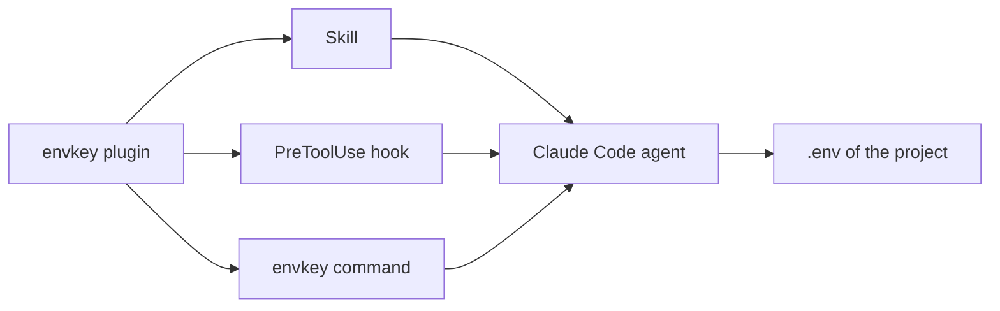
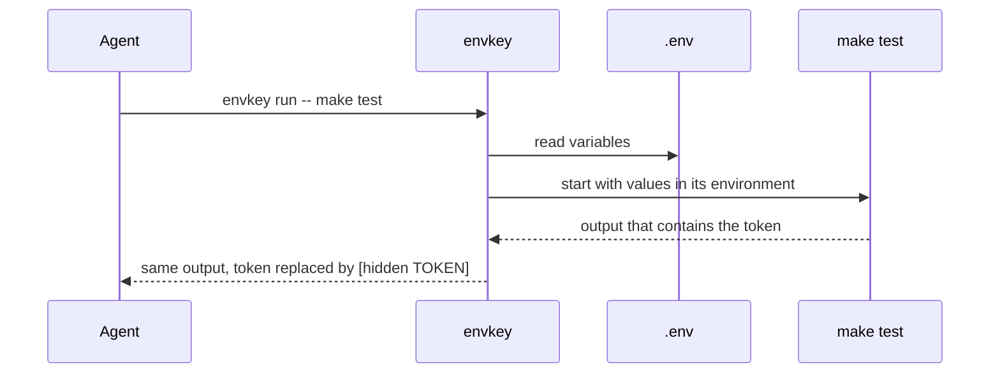

# envkey

A Claude Code plugin that lets the agent use a project's `.env` by variable name, without ever seeing a value.

[](https://github.com/daniil4545/envkey/actions/workflows/ci.yml)
[](https://github.com/daniil4545/envkey/releases)
[](LICENSE)

![Terminal demo: the agent stores a secret, runs a command that needs it and sees [hidden API_TOKEN], and the hook refuses cat .env](assets/demo.gif)

An agent that works on a real project needs keys: a database URL for `psql`, a token for `curl`,
an API key for tests. Both usual choices are bad:

| Approach | Problem |
|---|---|
| Let the agent read `.env` | every secret lands in the chat transcript and in logs |
| Forbid `.env` completely | the agent cannot run anything that needs a key, and you do it by hand |

envkey sits in between. The agent works with variables by name, and envkey handles the values.
You install it once and do not touch it again.

## Features

| What | In one line |
|---|---|
| Run with keys | `envkey run -- <cmd>` starts a command with `.env` in its environment |
| Masked output | every secret value in the output becomes `[hidden NAME]` |
| Hook | direct `Read`, `Edit`, `Grep` or `cat` on an env file is refused with a pointer to envkey |
| Edit by name | the agent adds, renames and removes variables itself |
| Secret input | a value only you know goes through a hidden prompt or a macOS dialog, never the chat |
| Public marks | `# public` above a line shows its value in `envkey ls`; everything else is secret |
| Plain dotenv | `make`, `docker compose` and your app read the same file as before |
| No setup | Python standard library only, no configuration file |

## Install

Needs Claude Code, Python 3.9 or newer and git. Works on macOS and Linux; the secret dialog
needs macOS, elsewhere pipe the value (`... | envkey set NAME`).

```sh
claude plugin marketplace add daniil4545/envkey
claude plugin install envkey@envkey
```

Restart Claude Code. Nothing else to configure. Update with
`claude plugin update envkey@envkey`, remove with `claude plugin uninstall envkey@envkey`.

## Quick start

Ask the agent for what you need in plain words, for example "add the API token and run the
tests". The plugin's skill makes it use `envkey`. These are the commands it runs, with their
real output:

1. Store a secret it produced itself, and a public setting:

   ```sh
   echo 'fake-token-8f3a91c2d4' | envkey set API_TOKEN
   envkey set --public PORT 8080
   ```

   ```text
   envkey: API_TOKEN saved (secret)
   envkey: PORT saved (public)
   ```

2. List the variables. Secrets show only their names:

   ```sh
   envkey ls
   ```

   ```text
   envkey: .../shop/.env
   API_TOKEN	<secret>
   PORT	8080
   ```

3. Run a command that needs them. The agent reads output through a pipe, so the token is hidden:

   ```sh
   envkey run -- sh -c 'echo "port=$PORT token=$API_TOKEN"' | cat
   ```

   ```text
   port=8080 token=[hidden API_TOKEN]
   ```

4. For a secret only you know, the agent runs `envkey set API_TOKEN` and tells you one line:
   "Enter API_TOKEN in the envkey dialog". A dialog with hidden input opens on your Mac, and
   the value goes straight into `.env`.

`.env` must be in `.gitignore` first; otherwise `envkey set` refuses to write.

## Commands

| Command | What it does |
|---|---|
| `envkey ls` | names; values of public variables, `<secret>` for the rest |
| `envkey run -- <cmd>` | runs `<cmd>` with `.env` in its environment, secrets masked |
| `envkey set --public NAME VALUE` | adds or changes a public variable |
| `envkey set --public NAME` | marks an existing variable public, keeps its value |
| `envkey set NAME` | stores a secret: stdin, hidden prompt or macOS dialog |
| `envkey rm NAME` | removes a variable and its `# public` mark |
| `envkey mv OLD NEW` | renames a variable, the mark stays with it |

`-C DIR` before the command starts the search in another directory:
`envkey -C services/api run -- make test`. `-f FILE` uses an env file with any name instead of
the search: `envkey -f secrets/db.env ls`.

## How it works

Claude Code puts the plugin's `bin/` directory on the agent's `PATH`, so `envkey` is available in
every session without touching your shell.



| Part | File | Role |
|---|---|---|
| Command | `bin/envkey` | reads and edits `.env`, runs commands with its values, masks secrets in output |
| Skill | `skills/envkey/SKILL.md` | tells the agent to use envkey for anything about environment variables |
| Hook | `hooks/guard.py` | checks every Read, Edit, Write, Grep and Bash call; refuses direct access to `.env` and `<name>.env` |

### Running a command with keys



1. The agent writes only names: `envkey run -- make test` or
   `envkey run -- sh -c 'curl -H "Authorization: Bearer $TOKEN" ...'`.
2. envkey finds the nearest `.env`, from the current directory up to the git root.
3. Values go into the environment of the child process, never into arguments.
4. envkey reads the child's stdout and stderr line by line and replaces every secret value
   with `[hidden NAME]`.
5. The child's exit code is returned unchanged, so the agent knows whether the command failed.

### The mask

| Rule | Value |
|---|---|
| What is matched | exact occurrences of a secret value |
| Which values | secrets only; public variables are shown as is |
| Minimum length | 6 characters; shorter values such as `1` or `true` are not masked |
| Order | longest values first, so a value that contains another is replaced whole |
| Where | stdout and stderr of the child, line by line |
| When | when output goes to a pipe, which is always the case for the agent. In your own terminal the command runs directly, without a mask |

### Public and secret variables

A variable is public only when the line above it is `# public`. Everything else is a secret.

```text
# public
PORT=8080
API_TOKEN=...
```

Secret is the default because a wrong guess that way only hides a harmless value. The agent
marks a variable public without seeing it: `envkey set --public PORT`. It does this for ports,
hosts, log levels, flags and model names; tokens, passwords, keys and URLs with credentials stay
secret.

### The hook

- `cat .env`, `source .env`, Read on `.env`: refused. The refusal lists the envkey commands, and
  the agent switches to them on its own.
- `.env.example`, `.gitignore` and any `envkey ...` command pass.

### Giving the agent a secret

1. The agent produced the value itself, for example a password:
   `openssl rand -hex 16 | envkey set DB_PASSWORD`.
2. Only you know the value: the agent runs `envkey set API_TOKEN`, and a dialog with hidden input
   opens on your Mac. The value goes from the dialog to envkey and never through the chat.
3. You set it yourself in a terminal: `envkey set API_TOKEN` asks with a hidden prompt.

The file is written to a temporary file and swapped in one step, with mode 0600. Other lines,
comments and line endings stay byte for byte. envkey rejects a value with `#`, `$`, a backslash,
surrounding quotes or edge spaces, because `make` and `docker compose` would read it differently.

## Setup and options

There is no configuration file. A few situations worth knowing:

| Situation | What to do |
|---|---|
| Existing project with a `.env` | nothing; every variable starts as secret. Ask the agent to mark the harmless ones public |
| No `.env` yet | the agent creates it with `envkey set`; `.env` must be in `.gitignore` first, the agent adds it with the Edit tool |
| Several services with their own `.env` | `envkey -C <service dir> ...`; each command finds the nearest file |
| Monorepo, `.env` at the root | works from any subdirectory: the search goes up to the git root |
| Git worktree | the file stays in the main tree; envkey in a worktree finds it there |
| File with another name (`db.env`, `accounts/a.env`) | `envkey -f <file> ...`; the hook blocks direct access to it as to `.env` |
| Value with `#`, spaces or several lines | wrap it in double quotes in the file, as docker compose reads it; `envkey set` still accepts only plain values |
| Stronger protection | add `"deny": ["Read(**/.env)"]` to `permissions` in your Claude Code settings; the hook already covers it, this adds a second layer |

## Security

| Promise | Checked by |
|---|---|
| `envkey ls` never prints a secret value | `test_ls_shows_public_values_only` |
| Output of `envkey run` hides secrets, public values stay, exit code is kept | `test_run_masks_secrets_keeps_public_and_exit_code` |
| Multi-line and quoted secrets are masked whole | `test_multiline_secret_masked_line_by_line`, `test_quoted_secret_with_hash_is_masked_whole`, `test_multiline_secret_masked_in_crlf_file` |
| A secret value is never taken as an argument | `test_secret_value_not_accepted_as_argument` |
| `envkey set` refuses a file that git does not ignore | `test_set_refuses_file_not_ignored_by_git` |
| The dialog value travels on stdout of `osascript`, not in arguments | `test_set_secret_without_stdin_uses_dialog`, comment in `ask_dialog` |
| The hook refuses reads of env files in file tools and in shell commands | `GuardTest.test_file_tools`, `test_grep_glob`, `test_bash` |

## Limits

envkey protects against accidental leaks, not against a command written to get around it.

- A transformed value passes the mask: `base64`, `rev`, printing character by character.
- The mask works line by line; a value split by a line break in the program's output passes.
- Binary output through `envkey run` is decoded as UTF-8 with replacement and may be altered.
- Secrets shorter than 6 characters are not masked.
- `.env` is a plain file readable by your user. The hook catches direct access, not every way to
  reach the file.
- The secret dialog works on macOS only.

<details>
<summary>Why does the agent see the output at all?</summary>

The agent has to see results to do its job, so output is not hidden wholesale. envkey hides only
the exact secret values and leaves everything else readable.
</details>

<details>
<summary>The agent wants to read .env and the hook stops it. Is that a bug?</summary>

No, it is the point. The refusal message lists the envkey commands, and the agent uses them on
its next call.
</details>

<details>
<summary>Do I have to run envkey myself?</summary>

No. The agent runs it. You only type a secret into the dialog when the agent asks.
</details>

## Development

```sh
python3 -m unittest discover -s tests -v    # tests
uvx ruff@0.14.0 check .                     # linter
claude plugin validate .                    # plugin and marketplace manifests
claude --plugin-dir .                       # run Claude Code with the local plugin
vhs docs/demo.tape                          # re-record the demo
```

See [CHANGELOG.md](CHANGELOG.md) for releases. Rules for agents working on envkey itself:
[AGENTS.md](AGENTS.md).

## License

[MIT](LICENSE)
