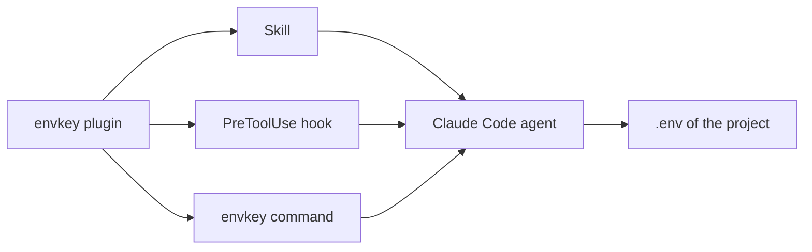
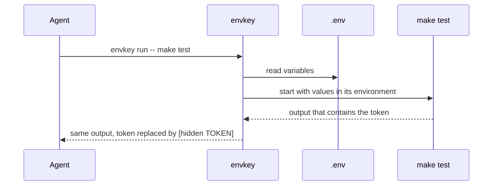
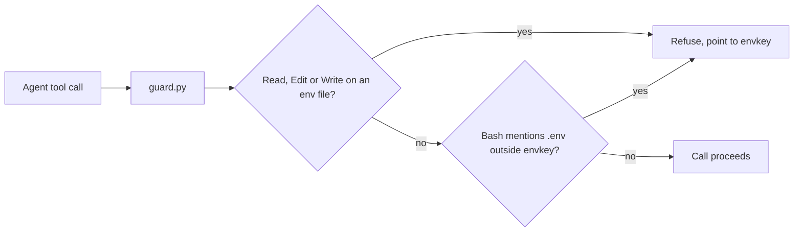
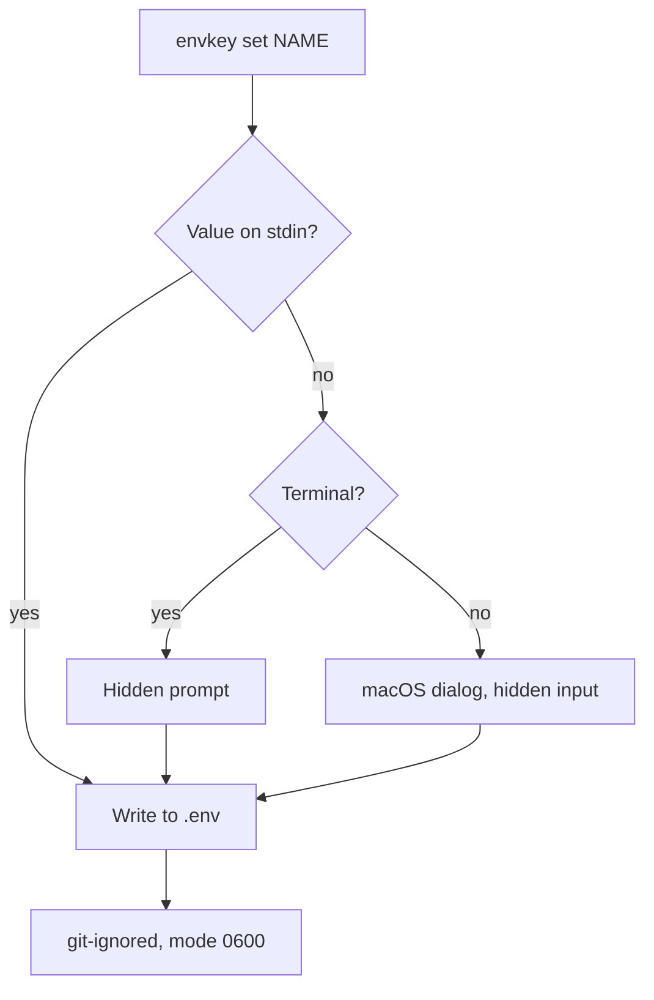

# envkey

A Claude Code plugin that gives the agent hands for a project's `.env`. The agent lists, uses,
adds, renames and removes variables, and never sees secret values. You install it once and
do not touch it again.

## Contents

1. Why
2. Install
3. How it works
4. Public and secret variables
5. Giving the agent a secret
6. Commands
7. Setup and options
8. Limits
9. Development

## 1. Why

An agent that works on a real project needs keys: a database URL for `psql`, a token for
`curl`, an API key for tests. The usual choices are both bad:

| Approach | Problem |
|---|---|
| Let the agent read `.env` | every secret lands in the chat transcript and in logs |
| Forbid `.env` completely | the agent cannot run anything that needs a key, you do it by hand |

envkey sits in between. The agent works with variables by name, and envkey handles the values:

- the agent runs commands with keys, without the values entering its context;
- the agent adds, renames and removes variables itself;
- the only thing left for you is typing a secret the agent cannot know, into a dialog;
- `.env` stays a plain dotenv file, so `make`, `docker compose` and your app read it as before;
- no configuration: the plugin's skill teaches the agent, its hook stops direct file access.

## 2. Install

Requirements: macOS, Python 3.9 or newer, git, Claude Code.

```sh
claude plugin marketplace add daniil4545/envkey
claude plugin install envkey@envkey
```

Restart Claude Code. Done: there is nothing to configure.

Update: `claude plugin update envkey@envkey`, then restart.
Remove: `claude plugin uninstall envkey@envkey`.

## 3. How it works

The plugin has three parts.



| Part | File | Role |
|---|---|---|
| Command | `bin/envkey` | reads and edits `.env`, runs commands with its values, masks secrets in output |
| Skill | `skills/envkey/SKILL.md` | tells the agent to use envkey for anything about environment variables |
| Hook | `hooks/guard.py` | checks every Read, Edit, Write, Grep and Bash call; refuses direct access to `.env` and `<name>.env` |

Claude Code puts the plugin's `bin/` directory on the agent's `PATH`, so `envkey` is available
in every session without touching your shell.

### Running a command with keys



1. The agent writes only names: `envkey run -- make test` or
   `envkey run -- sh -c 'curl -H "Authorization: Bearer $TOKEN" ...'`.
2. envkey finds the nearest `.env`, from the current directory up to the git root.
3. Values go into the environment of the child process, never into arguments.
4. envkey reads the child's stdout and stderr line by line and replaces every secret value
   with `[hidden NAME]`.
5. The child's exit code is returned unchanged, so the agent knows whether the command failed.

### The mask

| Rule | Value |
|---|---|
| What is matched | exact occurrences of a secret value |
| Which values | secrets only; public variables are shown as is |
| Minimum length | 6 characters; shorter values such as `1` or `true` are not masked |
| Order | longest values first, so a value that contains another is replaced whole |
| Where | stdout and stderr of the child, line by line |
| When | when output goes to a pipe, which is always the case for the agent. In your own terminal the command runs directly, without a mask |

### The hook



- `cat .env`, `source .env`, Read on `.env`: refused. The refusal lists the envkey commands,
  and the agent switches to them on its own.
- `.env.example`, `.gitignore` and any `envkey ...` command pass.

## 4. Public and secret variables

A variable is public only when the line above it is `# public`. Everything else is a secret.

```
# public
PORT=8080
API_TOKEN=sk-live-...
```

| Line | `envkey ls` shows | Masked in `envkey run` |
|---|---|---|
| with `# public` above | `PORT	8080` | no |
| without the mark | `API_TOKEN	<secret>` | yes |

Secret is the default because a wrong guess that way only hides a harmless value. The agent
marks a variable public without seeing it: `envkey set --public PORT`. It does this for ports,
hosts, log levels, flags and model names; tokens, passwords, keys and URLs with credentials stay
secret.

## 5. Giving the agent a secret



1. The agent produced the value itself, for example a password:
   `openssl rand -hex 16 | envkey set DB_PASSWORD`.
2. Only you know the value: the agent runs `envkey set API_TOKEN` and tells you one line,
   "Enter API_TOKEN in the envkey dialog". A dialog with hidden input opens on your Mac. The
   value goes from the dialog to envkey and never through the chat.
3. You set it yourself in a terminal: `envkey set API_TOKEN` asks with a hidden prompt.

Before writing, envkey checks that:

- `.env` is ignored by git, otherwise the next push would publish it;
- the value has no `#`, `$`, backslash, surrounding quotes or edge spaces, which `make` and
  `docker compose` would read differently.

The file is written to a temporary file and swapped in one step, with mode 0600. Other lines,
comments and line endings stay byte for byte.

## 6. Commands

| Command | What it does |
|---|---|
| `envkey ls` | names; values of public variables, `<secret>` for the rest |
| `envkey run -- <cmd>` | runs `<cmd>` with `.env` in its environment, secrets masked |
| `envkey set --public NAME VALUE` | adds or changes a public variable |
| `envkey set --public NAME` | marks an existing variable public, keeps its value |
| `envkey set NAME` | stores a secret: stdin, hidden prompt or macOS dialog |
| `envkey rm NAME` | removes a variable and its `# public` mark |
| `envkey mv OLD NEW` | renames a variable, the mark stays with it |

`-C DIR` before the command starts the search in another directory:
`envkey -C services/api run -- make test`. `-f FILE` uses an env file with any name instead of
the search: `envkey -f secrets/db.env ls`.

## 7. Setup and options

There is no configuration file. A few situations worth knowing:

| Situation | What to do |
|---|---|
| Existing project with a `.env` | nothing; every variable starts as secret. Ask the agent to mark the harmless ones public |
| No `.env` yet | the agent creates it with `envkey set`; `.env` must be in `.gitignore` first, the agent adds it with the Edit tool |
| Several services with their own `.env` | `envkey -C <service dir> ...`; each command finds the nearest file |
| Monorepo, `.env` at the root | works from any subdirectory: the search goes up to the git root |
| Git worktree | the file stays in the main tree; envkey in a worktree finds it in the same place there |
| File with another name (`db.env`, `accounts/a.env`) | `envkey -f <file> ...`; the hook blocks direct access to it as to `.env` |
| Value with `#`, spaces or several lines | wrap it in double quotes in the file, as docker compose reads it; `envkey set` still accepts only plain values |
| Stronger protection | add `"deny": ["Read(**/.env)"]` to `permissions` in your Claude Code settings; the hook already covers it, this adds a second layer |

## 8. Limits

envkey protects against accidental leaks, not against a command written to get around it.

- A transformed value passes the mask: `base64`, `rev`, printing character by character.
- The mask works line by line; a value split by a line break in the program's output passes.
- Binary output through `envkey run` is decoded as UTF-8 with replacement and may be altered.
- Secrets shorter than 6 characters are not masked.
- `.env` is a plain file readable by your user. The hook catches direct access, not every way
  to reach the file.
- macOS only for the dialog; on other systems pipe the value: `... | envkey set NAME`.

## 9. Development

| What | Command |
|---|---|
| tests | `python3 -m unittest discover -s tests -v` |
| run Claude Code with the local plugin | `claude --plugin-dir .` |

Rules for agents working on envkey itself: `AGENTS.md`.
